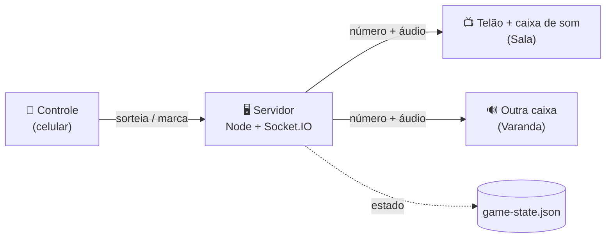

<div align="center">

# 🎱 Bingo da Família

**O notebook vira o telão e a caixa de som. O celular vira o controle.**
Cada número sorteado aparece grande na TV e é falado em voz alta, com voz neural em português.


</div>

<table>
  <tr>
    <td width="72%"></td>
    <td width="28%"></td>
  </tr>
  <tr>
    <td align="center"><b>Telão</b> — fica na TV ou no notebook ligado à caixa de som</td>
    <td align="center"><b>Controle</b> — no celular de quem canta</td>
  </tr>
</table>

## Como funciona



Quem canta usa o celular. O servidor guarda o jogo e avisa todas as telas na hora; cada tela com som ativado fala o número. Dá para ter várias caixas de som e escolher em qual tocar.

## O que dá para fazer

**No telão**
- 🎱 Bola grande com o último número, colorida pela letra (B azul, I vermelho, N branco, G verde, O laranja)
- 🟦 Cartela com os 75 números; os sorteados acendem e o número atual fica destacado
- 🕘 Os últimos números em fichas, para quem se distraiu
- 🗣️ Fala cada número com voz neural pt-BR ("Letra N. Número 44"), com opção de falar duas vezes
- 📲 QR code no canto para abrir o controle no celular
- ⛶ Tela cheia e tela sempre acesa (não apaga no meio do jogo)

**No celular (controle)**
- 🎲 **Sortear número**, ou tocar no número que saiu do globo físico
- 🔁 **Repetir último** · ↩️ **Desfazer último** (toque errado acontece)
- 📣 **Falar todos os números** em ordem, destacando cada um no telão enquanto fala
- 🎙️ **Segure para falar**: grava sua voz e toca na caixa de som, com volume ajustado para ficar parecido com a voz da IA
- 💬 **Respostas rápidas**: "Sim, já saiu!", "Ainda não saiu", "Vamos conferir", "Temos vencedor!", "Um momento"
- 🔎 **Modo conferir**: quando alguém grita bingo, toque nos números da cartela dele para ver se já saíram, sem marcar nada
- 🔊 **Escolher a caixa de som**: tocar em todas, só em uma, ou no próprio celular
- ⚙️ Três vozes (Francisca, Antonio, Thalita), novo jogo e opções

**Por trás**
- 💾 O jogo é salvo em disco: reiniciar o servidor ou recarregar a página não perde os números
- 🔒 Controle protegido por senha; em produção o app nem sobe sem senha forte
- 🏠 Salas: `?sala=nome` abre outro jogo independente no mesmo servidor

## Começar em 2 minutos

Precisa de [Node.js](https://nodejs.org) 22 ou mais novo.

```bash
git clone https://github.com/joaoleite/bingo.git
cd bingo
npm install
npm start
```

1. No notebook ligado à caixa de som, abra **http://localhost:3000**, clique em **Ativar som** e, se quiser, em **Tela cheia**.
2. No celular, no mesmo Wi-Fi, escaneie o QR code do canto da tela (ou abra o endereço `http://<ip-do-notebook>:3000/admin` que aparece no terminal). Login padrão: `admin` / `admin`.
3. Toque em **🎲 Sortear número** ou no número que saiu do globo. Pronto.

O chip no topo do controle mostra quantas caixas de som estão ativas. Se aparecer "nenhuma caixa de som", clique em **Ativar som** na tela do notebook.

> **Microfone:** o navegador do celular só libera o microfone (o "segure para falar") em endereço **https**. Na rede local por `http://`, o resto funciona normalmente; para usar a voz, publique com HTTPS (veja abaixo).
>
> **ffmpeg** (opcional): se estiver instalado, as gravações do celular são convertidas para MP3 com volume normalizado. Sem ele, a gravação toca como veio.

## Configuração

| Variável | Padrão | Para quê |
|---|---|---|
| `PORT` | `3000` | Porta HTTP |
| `ADMIN_USER` / `ADMIN_PASS` | `admin` / `admin` | Login do controle. Com `NODE_ENV=production`, o app **não sobe** se a senha for `admin` ou tiver menos de 8 caracteres |
| `PUBLIC_URL` | descobre pelo acesso | Endereço usado no QR code, ex.: `https://bingo.seudominio.com` |
| `STATE_FILE` | `game-state.json` | Onde o jogo em andamento é salvo |

## Publicar com Docker

```bash
docker build -t bingo .
docker run -d -p 3000:3000 \
  -e ADMIN_PASS='uma-senha-forte' \
  -e PUBLIC_URL='https://bingo.seudominio.com' \
  -v bingo-dados:/data \
  bingo
```

O volume `/data` guarda o jogo e faz ele sobreviver a atualizações. O `docker-compose.yaml` do repositório é o usado em produção no [Coolify](https://coolify.io) (o proxy dele cuida do HTTPS); serve de modelo para qualquer plataforma com Docker Compose.

## Estrutura

```
server.js              Express + Socket.IO: sorteio, marcação, voz, gravações, QR
gameState.js           Estado das salas, salvo em JSON (com mutex)
public/index.html      Telão / caixa de som        → js/display.js
public/admin.html      Controle no celular          → js/admin.js
public/js/common.js    Cartela, bola, tocador de áudio
public/audio/<voz>/    MP3 de cada número e das respostas rápidas
scripts/gerar-audios.sh  Gera os áudios de uma voz
```

**Outra voz:** `scripts/gerar-audios.sh pt-BR-AntonioNeural` gera os áudios com [edge-tts](https://github.com/rany2/edge-tts) (precisa de internet e [uv](https://docs.astral.sh/uv/)). Depois cadastre a voz em `VOICES` (`server.js`) e em `public/js/common.js`.

## A história deste repositório

Este bingo foi o projeto que usei para aprender a trabalhar com cada nova geração de IA. Cada tentativa nasceu num repositório diferente; hoje estão todas aqui, cada uma numa tag com o histórico completo:

| Versão | Tag | Quando | Como era |
|---|---|---|---|
| v1 | `v1-bingoplay` | 2025 | Node + Socket.IO, voz do navegador |
| v2 | `v2-bingomaster` | dez/2025 | Protótipo React gerado no Google AI Studio |
| v3 | `v3-bingoplaypwa` | abr/2026 | React + PWA offline para iPhone (nunca funcionou direito) |
| v4 | `v4.0.0` | 2026 | **Esta.** Voz neural, controle no celular, várias caixas de som |

```bash
git checkout v1-bingoplay   # volta no tempo
git checkout main           # e volta para a versão atual
```

Detalhes em [CHANGELOG.md](./CHANGELOG.md). Ideias para as próximas versões em [MELHORIAS.md](./MELHORIAS.md).

## Licença

[MIT](./LICENSE) © João Leite
